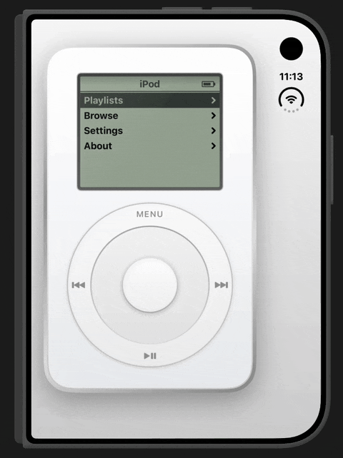
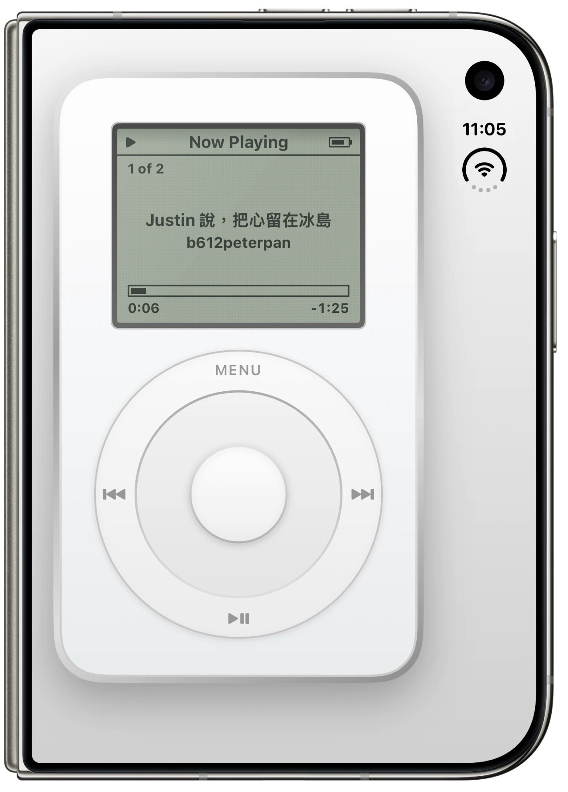
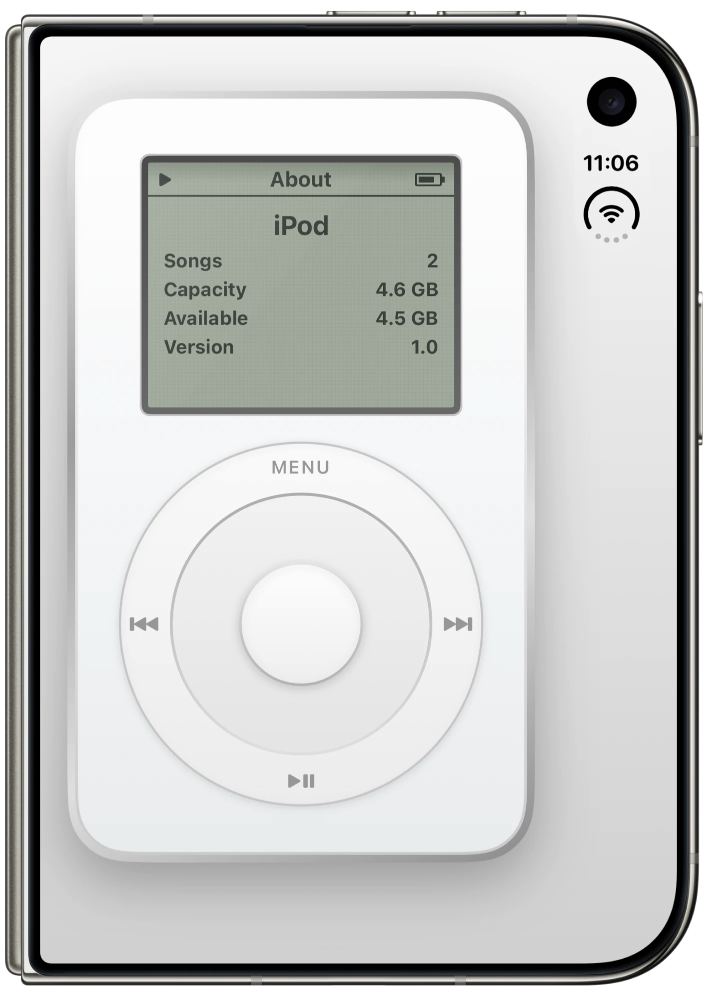

# 🎵 SwiftUI iPod (1st Generation)

**English** · [繁體中文](#zh-tw)

## ✨ About

A pixel‑faithful recreation of the **2001 first‑generation iPod**, built entirely in SwiftUI. It has the look of the original and works the way it did: spin the scroll wheel, click through the menus and play music.

## 📸 Screenshots

  
  &nbsp;&nbsp;
  

## 🎬 Video

▶️ <https://youtube.com/shorts/OArLHTPaQVM>

## 🎨 Look

- 🤍 White acrylic front with a polished stainless‑steel rim, using the original 102 × 62 mm proportions
- 🟩 Grey‑green monochrome LCD that glows blue‑white with the backlight on, with a faint dot‑matrix grid
- 🔋 Title bar with play/pause and battery icons; the selected row is shown inverted
- 🎛️ Mechanical scroll wheel ringed by **MENU / ⏮ / ⏭ / ▶❚❚**, with a center select button

## 🕹️ Controls

| Action | What it does |
| --- | --- |
| 🔄 Spin the wheel | Move through menus. A click sound and haptic every 15°. Adjusts volume on Now Playing |
| ⏺️ Center button | Select. On Now Playing, toggles scrubbing (the wheel seeks) |
| ⏮ / ⏭ | Previous / next track. ⏮ restarts the song if it's past 3 seconds |
| ✋ Hold **MENU** | Toggle the backlight |
| 😴 Hold **▶❚❚** | Sleep. Any button wakes the iPod |
| ⌨️ Keyboard | ↑↓ wheel · ←→ prev/next · Return select · Space play/pause · Esc menu |

**Menus:** Playlists · Browse (Artists / Albums / Songs) · Settings (Shuffle, Repeat, Backlight Timer, Contrast, Clicker) · About

## 🎶 Songs

Two bundled tracks. Title and artist are read from the MP3 ID3 tags:

- 🇮🇸 *Justin 說，把心留在冰島* — b612peterpan
- 🌱 *小小的夢想 (Little Dreams)* — b612peterpan

Drop any other `.mp3` into the `ipod/` folder and it shows up automatically.

## 🛠️ Build & Run

1. Open `ipod.xcodeproj` in **Xcode 27**
2. Pick an iPhone simulator, Mac, or Apple Vision Pro
3. Press **⌘R** 🚀

## 🗂️ Project Structure

| File | Purpose |
| --- | --- |
| `IPodView.swift` | Device body, screen bezel and the scroll wheel with its gestures |
| `LCDView.swift` | The 160 × 128 LCD: menus, Now Playing, About, Contrast |
| `IPodModel.swift` | Firmware state: menu stack, settings, backlight, sleep |
| `AudioPlayer.swift` | AVAudioPlayer playback queue with shuffle and repeat |
| `ClickSound.swift` | Synthesized piezo‑style click |
| `Song.swift` | Loads the bundled MP3s and their metadata |

---

# 🎵 SwiftUI iPod（第一代）

[English](#english) · **繁體中文**

## ✨ 簡介

用 SwiftUI 打造的 **2001 年第一代 iPod** 復刻版，外觀跟原機一樣，操作方式也一樣：轉動滾輪、按鍵切換選單、播放音樂。

## 📸 截圖

  
  &nbsp;&nbsp;
  

## 🎬 影片

▶️ <https://youtube.com/shorts/OArLHTPaQVM>

## 🎨 外觀

- 🤍 白色壓克力正面加上拋光不鏽鋼邊框，比例照原機 102 × 62 mm
- 🟩 灰綠色單色 LCD，背光開啟時變成藍白色，並帶有淡淡的像素點陣格線
- 🔋 標題列有播放／暫停圖示和電池圖示，選到的那一列會反白
- 🎛️ 機械式滾輪，外圈是 **MENU / ⏮ / ⏭ / ▶❚❚** 四個按鍵，正中央是選擇鍵

## 🕹️ 操作

| 動作 | 功能 |
| --- | --- |
| 🔄 轉動滾輪 | 在選單中移動，每轉 15° 發出「喀」聲並震動一下；在 Now Playing 畫面則是調整音量 |
| ⏺️ 中央鍵 | 選擇；在 Now Playing 畫面按一下會進入快轉／倒轉模式，這時滾輪用來移動播放位置 |
| ⏮ / ⏭ | 上一首／下一首；歌曲已經播超過 3 秒時按 ⏮，會回到這首的開頭 |
| ✋ 長按 **MENU** | 開關背光 |
| 😴 長按 **▶❚❚** | 進入休眠，按任何鍵就會醒來 |
| ⌨️ 鍵盤 | ↑↓ 滾輪 · ←→ 上一首／下一首 · Return 選擇 · Space 播放／暫停 · Esc 返回 |

**選單：** Playlists · Browse（Artists／Albums／Songs）· Settings（Shuffle、Repeat、Backlight Timer、Contrast、Clicker）· About

## 🎶 歌曲

內建兩首歌，歌名和演出者讀取自 MP3 的 ID3 標籤：

- 🇮🇸 *Justin 說，把心留在冰島* — b612peterpan
- 🌱 *小小的夢想 (Little Dreams)* — b612peterpan

把其他 `.mp3` 放進 `ipod/` 資料夾，就會自動出現在歌曲清單裡。

## 🛠️ 建置與執行

1. 用 **Xcode 27** 開啟 `ipod.xcodeproj`
2. 選擇 iPhone 模擬器、Mac 或 Apple Vision Pro
3. 按下 **⌘R** 🚀

## 🗂️ 專案結構

| 檔案 | 用途 |
| --- | --- |
| `IPodView.swift` | 機身、螢幕邊框，以及滾輪和它的手勢 |
| `LCDView.swift` | 160 × 128 LCD 畫面：選單、Now Playing、About、Contrast |
| `IPodModel.swift` | 韌體狀態：選單層級、設定、背光、休眠 |
| `AudioPlayer.swift` | 以 AVAudioPlayer 實作的播放佇列，支援隨機播放與重複播放 |
| `ClickSound.swift` | 合成的壓電喇叭「喀」聲 |
| `Song.swift` | 載入內建的 MP3 和它們的歌曲資訊 |

<a href="#english">⬆️ Back to English</a>

